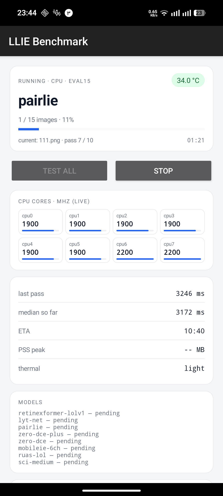

# LLIE Mobile Bench

An Android app that benchmarks **low-light image enhancement (LLIE) models on
the real phone**, not on a desktop GPU: end-to-end latency, thermal behaviour,
per-core frequency, memory, and the enhanced outputs, measured with a frozen
protocol on a real device.

The app is the measurement half of a reproducibility study; the companion
numbers (PSNR/SSIM/LPIPS on eval15) are computed on the host from the saved
outputs.

## What it does

- Runs eight exported ONNX models on the phone's CPU with ONNX Runtime:
  Zero-DCE, SCI (medium), RUAS (LOL), Zero-DCE++, PairLIE, MobileIE-6Ch,
  LYT-Net, Retinexformer (LOL-v1).
- **Live monitor**: image/pass progress, ETA, battery-temperature pill,
  per-core MHz grid with load bars, last/median pass, PSS peak, thermal status.
- **Test all**: queues every staged model heavy→light, waits for the battery to
  cool to 38 °C between models, skips models that already have a valid run, and
  uploads each finished run.
- **Stop** (with confirmation): the running model closes as `success=false`,
  `failure_reason="stopped by user"`, and the queue halts.
- **Setup from server**: pulls the models, manifests and eval15 images in one
  zip, so a new phone needs only the APK.
- **Device label**: distinguishes two physically identical phones in the
  uploaded data (e.g. `2a-lab`, `9t-home`).

## Measurement protocol (v2)

- batch = 1, CPU backend, float32, ONNX Runtime
- 15 paired eval15 images, warm-up 5 passes, **10 measured passes** per image
- timing inside the app with `SystemClock.elapsedRealtimeNanos`; ADB never
  enters the timing loop
- battery temperature, charge state, screen state, thermal status and per-core
  frequencies recorded before/after and at every image
- a run whose latency drifts >15 % (last third vs first third) is rejected

## Install

Download the latest APK from the [Releases](../../releases) page:

| File | Use |
|---|---|
| `llie-bench-*-arm64-v8a.apk` | almost every modern phone |
| `llie-bench-*-armeabi-v7a.apk` | older 32-bit phones |
| `llie-bench-*-universal.apk` | safe fallback |
| `llie-bench-*-x86_64.apk` | emulator / ChromeOS |

Requires Android 8.0 (API 26) or newer. Releases are **debug-signed** on
purpose: this is a sideloaded research tool.

First run: open the app → optionally set a device label → **Setup from server**
(downloads ~13 MB) → **Test all**. Keep the phone unlocked and screen-on for
the whole run (the app holds the screen awake), do not charge it, and expect
40–90 minutes depending on the phone.

## What gets uploaded

Each finished run posts `run.json`, `status`, and the enhanced PNGs to the
project's receiver when the build has a server configured. `run.json` contains
the model artifact hash, device model/SoC/Android build, per-image timing
samples, battery temperature, per-core frequencies, PSS samples and the quality
outputs. No account, serial number or personal data is collected.

## Build from source

Requirements: JDK 17, Android SDK 34.

```bash
./gradlew testDebugUnitTest assembleDebug
# ABI-split APKs land in app/build/outputs/apk/debug/
```

The upload server is injected at build time (the public source contains no
endpoint or token):

```bash
./gradlew assembleDebug \
  -PllieServerUrl=http://your-host:8770 \
  -PllieServerToken=your-token
```

Without those properties **Setup from server** and auto-upload stay disabled;
you can still stage `models/`, `manifests/` and `images/eval15/` into the app's
files directory with adb and run **Test all**. Host-triggered runs must pass the
`run_token` extra equal to `BuildConfig.RUN_TOKEN`; the activity ignores
anything else.

## Screenshots

<p align="center">
  
</p>

The monitor while PairLIE runs on a Nothing Phone (2a): run phase and battery
temperature, image/pass progress, per-core MHz with load bars, last/median pass,
ETA, thermal status and the staged model list.

## Models under test

Parameters are measured live from the exported ONNX initializers (not from
papers), and every model goes through a host-side export/parity gate before it
is shipped to the phone.

| Model | Approach | Params | Venue | PSNR (dB) | SSIM |
|---|---|---:|---|---:|---:|
| SCI (medium) | Self-calibrated illumination division | 252 | CVPR 2022 | 14.78 | 0.53 |
| Zero-DCE++ | Lightweight curve estimation, depthwise-separable convs, curves at ¼ resolution | 10,561 | TPAMI 2021 | 15.19 | 0.57 |
| RUAS (LOL) | Unrolled Retinex with an architecture-searched prior block | 1,161 | CVPR 2021 | 16.30 | 0.48 |
| MobileIE-6Ch | Reparameterized multi-branch CNN with a unified 6-channel head | 23,882 | ICCV 2025 | 17.91 | 0.72 |
| Zero-DCE | Zero-reference curve estimation (8 iterations) | 79,416 | CVPR 2020 | 14.80 | 0.56 |
| LYT-Net | YUV-space dual-path transformer (RGB→YCbCr in-graph) | 44,923 | IEEE SPL 2025 | 21.59 | 0.81 |
| PairLIE | Self-supervised paired-instance Retinex decomposition, γ = 0.14 | 341,767 | CVPR 2023 | 19.51 | 0.73 |
| Retinexformer | One-stage Retinex transformer with channel attention | 1,605,701 | ICCV 2023 | 25.07 | 0.84 |

Rows are ordered by median latency on the reference device (Nothing Phone
2a), fastest first, so the quality columns read as a speed/quality trade-off.
Quality columns are means over the 15 paired eval15 images and are
device-independent (same inputs and artifact on every phone).

## Results so far

Protocol v2: CPU / float32 / ONNX Runtime, 600×400 eval15, medians over
15 images × 10 measured passes. Quality is device-independent (same inputs and
same ONNX artifact on every phone).

**Median end-to-end latency (ms)**

| Device | SCI-m | Zero-DCE++ | RUAS | MobileIE | Zero-DCE | LYT-Net | PairLIE | Retinexformer |
|---|---:|---:|---:|---:|---:|---:|---:|---:|
| Nothing Phone (2a) | 21.8 | **84.3** | 115.4 | 355.3 | 972.7 | 1,075.3 | **3,664.3** | **6,035.5** |
| Redmi Note 10 Pro | 29.6 | 89.5 | 128.3 | 400.6 | 958.3 | 1,070.5 | 4,873.0 | 8,190.0 |
| Redmi 9T | 53.2 | — | 205.5 | 648.8 | 1,850.1 | 2,098.7 | — | — |

Community devices that ran the full eight-model set through the app
(MT6789 = Galaxy A24, Exynos 1280 = Galaxy A25):

| Device | SCI-m | Zero-DCE++ | RUAS | MobileIE | Zero-DCE | LYT-Net | PairLIE | Retinexformer |
|---|---:|---:|---:|---:|---:|---:|---:|---:|
| Galaxy A24 (MT6789) | 41.9 | 112.1 | 149.3 | 527.4 | 1,318.1 | 1,255.3 | 4,955.6 | 8,158.3 |
| Galaxy A25 (Exynos 1280) | 30.3 | 85.8 | 137.5 | 418.8 | 978.8 | 1,132.0 | 3,745.2 | 6,716.7 |

All models report the same eval15 PSNR/SSIM on every device (see the model
table), which is the invariant the pipeline is built to preserve — latency is
the only device-dependent part.

Only the Redmi 9T is still missing the three new models; that row is filled in
as those runs land. — فقط Redmi 9T مانده و جدول با نتایج آن کامل می‌شود.

## License

MIT — see [LICENSE](LICENSE).

## راهنمای سریع فارسی

1. از صفحه‌ی Releases فایل `arm64-v8a` را نصب کن.
2. اپ را باز کن؛ اگر خواستی یک **Device label** بگذار (مثلاً `2a-lab`).
3. **Setup from server** را بزن تا مدل‌ها و تصاویر دانلود شوند.
4. **Test all** را بزن؛ گوشی باید آنلاک و روشن بماند و در حین تست شارژ نشود.
5. برای توقف، دکمه‌ی **Stop** (با تأیید) را بزن.
